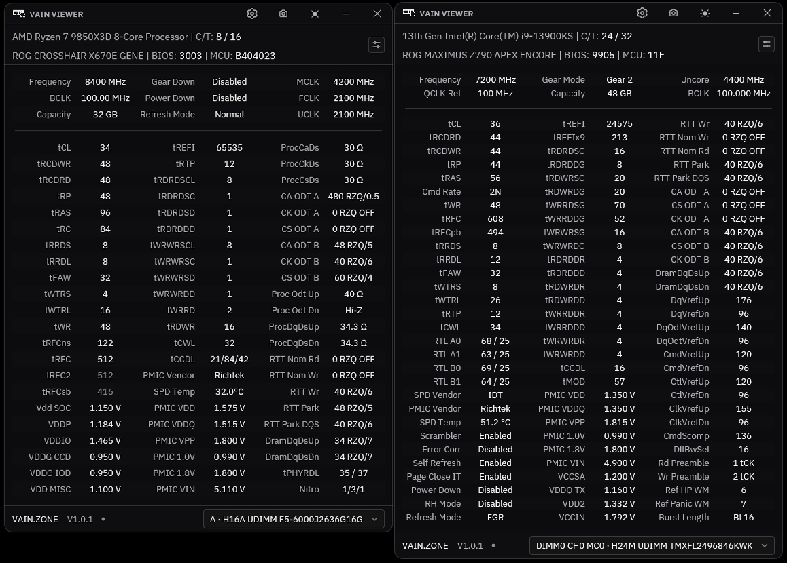

# VainViewer

A compact Windows viewer for memory overclocking: the timings, subtimings and voltages your DDR4 or DDR5 actually runs at, read live from the memory controller, the SPD and the board's sensors.

**[Download the latest release](https://github.com/flashhez/VainViewer/releases/latest)**: one `VainViewer.exe`, nothing to install.

*Left: AMD AM5, Ryzen 9000 with DDR5. Right: Intel LGA1700, Core 13th gen with DDR5.*

## Supported platforms

| Platform | CPUs | Memory |
| --- | --- | --- |
| AMD AM5 | Ryzen 7000 / 8000 (Zen 4), Ryzen 9000 (Zen 5) | DDR5 |
| Intel LGA1700 | Core 12th, 13th and 14th gen | DDR4 or DDR5 |
| Intel LGA1851 | Core Ultra 200S | DDR5 |

Zen 3 and LGA1200 are on the way. On other systems VainViewer says the platform isn't supported yet and closes.

## What it shows

- **Timings:** primary, secondary and tertiary, per DIMM, refreshed live; gear mode, command rate, tREFI, tRFC and their per-bank forms, turnarounds (tRDRD/tWRWR/tRDWR/tWRRD, SG/DG/DR/DD)
- **Signal integrity:** on-die termination (RTT Nom, RTT Wr, RTT Park, DQS Park; CA, CK and CS ODT per group), drive strengths for the CPU and the DRAM (CA, CK, CS, DQ pull-up/down), and CPU ODT
- **Intel compensation:** RCOMP and Vref (DQ, DQ ODT, CMD, CTL, CLK up/down), CmdScomp, round-trip latencies (RTL), DLL, preambles and data-lane settings
- **AMD detail:** skews and slopes, tPHYRDL, Nitro, and the memory data the BIOS leaves in APOB
- **Voltages:** from the CPU (VDD SOC, VDDIO, VDDP, VDDG, VDD MISC, VCCSA, VDDQ TX), the DDR5 PMIC (VDD, VDDQ, VPP, 1.0 V, 1.8 V, VIN) and the board's Super I/O chip (VDD2, VCCIN, VCCSA)
- **Modules:** SPD with JEDEC, XMP and EXPO profiles, DRAM and PMIC vendor, DIMM temperature
- An **Advanced** window with the full controller, mode-register and SPD detail, searchable (Ctrl+F)
- WHEA error counts, and on AMD the CPU temperatures, power, clocks and throttling
- Screenshots of the window or the desktop, to a file or the clipboard
- Themes, colours, fonts and sizes you can change in Settings

## Requirements

- Windows 10 or 11, 64-bit
- Administrator rights: VainViewer reads hardware registers, so Windows asks for permission each time it starts
- [PawnIO](https://github.com/namazso/PawnIO), an open-source driver by namazso. If it isn't installed, VainViewer offers to install it on first start; it stays installed and can be removed in Windows Settings > Apps.

## Updates

Click the version number in the bottom-left corner. VainViewer checks this repository for a newer release and, if you agree, downloads it, checks its SHA-256 and signature, swaps it in and restarts.

## Windows warnings

VainViewer is signed with its own certificate, so Windows shows "Unknown publisher" and SmartScreen may warn on the first download. GitHub shows the SHA-256 of `VainViewer.exe` next to the file on each release; you can compare it with `certutil -hashfile VainViewer.exe SHA256`.

## Licences

VainViewer is free to use, personally and commercially; see [LICENSE.txt](LICENSE.txt). Please share the link to this page rather than the exe itself, so everyone gets the genuine, signed file. Screenshots and results are yours to post anywhere. It includes third-party software under its own licences (PawnIO under the GNU GPL v2, its modules under the GNU LGPL v2.1, InpOut under MIT, IBM Plex Sans under the SIL OFL, and MIT-licensed Rust libraries), listed with their sources in [THIRD-PARTY-NOTICES.txt](THIRD-PARTY-NOTICES.txt). The same list opens from Settings > About > Third-party licences.

[vain.zone](https://vain.zone)
